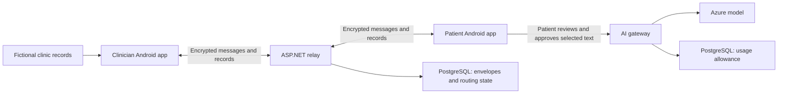

# System architecture

The phone keeps approved instructions and the next step available offline. Connected services support encrypted delivery and separately consented AI assistance.

| Component | Responsibility |
| --- | --- |
| Android app | Kotlin and Jetpack Compose. Shows source versions, an accepted care plan and its tasks. Deterministic rules calculate or cancel reminders. |
| Local evidence and storage | Links sources, passages, plans and tasks for keyword retrieval. Keeps public demo state separate from the connected Android Keystore-backed encrypted snapshot and journal. |
| ASP.NET Core and PostgreSQL | Runs health checks, communication and selected AI jobs. Stores scoped relay state and quota records. |
| Connected transport | Enrols synthetic endpoints, protects content with Virgil E3Kit, persists outbox and inbox state, and tracks receipts. |
| Optional AI | Receives the exact excerpt approved for sharing. Returns a source-linked explanation or draft. Clinical approval and saving or sending remain subject to application rules and review. |

The diagram describes the controlled connected setup. The downloadable app runs the synthetic case locally with simulated AI and care-team service events.

[Care rules and interfaces](workflows-and-interfaces.md) · [Privacy and clinical authority](privacy-and-safety.md) · [Documentation home](README.md)
